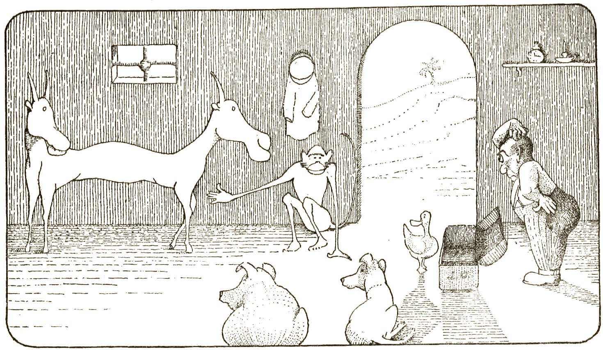

# Pushme-Pullyou

**Tools for exploring GitHub, each one a single HTML file.**

Vanilla HTML, CSS and JavaScript. No frameworks, no build tools, no server. Everything here runs on GitHub Pages or straight from a `file://` double-click.

The tools are named after the animals in Hugh Lofting's [Doctor Dolittle]( https://en.wikipedia.org/wiki/Doctor_Dolittle ) books — we spell the two-headed one **Pushme-Pullyou**, a nod to all the pushing and pulling that Git is made of. This organization's first commit was pushed in December 2016.

## The Menagerie

Each tool looks at GitHub through a wider lens than the one before.

| Tool | Scope | Dolittle character | Status |
| --- | --- | --- | --- |
| [TooToo]( https://pushme-pullyou.github.io/tootoo/ ) | One repo — drop it in and the repo becomes a browsable site | Too-Too the owl, the Doctor's accountant: keeps the books of one repo | Live — [source]( https://github.com/pushme-pullyou/tootoo ) |
| DabDab | One user — repos, organizations, stars: the whole household | Dab-Dab the duck, the housekeeper | In progress |
| GubGub | All of GitHub — whiz around and see what anyone is up to | Gub-Gub the pig, curious and always rooting about | In progress |
| JipJip | Right now — issues, pull requests, actions in flight | Jip the dog, whose nose finds where the action is | Planned |

And every animal is born in the same place: the **Pushme-Pullyou** workshop — the shared source and assembly pipeline. Like its namesake it has two heads working at once: one pulls improvements in from the animals, the other pushes finished builds out to each animal's repo. So the name means three things: the organization is the family, this site is the front door, and the workshop is where the work happens. For now the workshop lives inside the [tootoo]( https://github.com/pushme-pullyou/tootoo ) repo as `tootoo-dev`; it moves to its own repo once it assembles its second animal.

## The Archive

The original 2016–2019 site — earlier TooToos, the first GubGub, DabDab, CheeChee, JibJib and friends — is preserved intact at:

* <https://pushme-pullyou.github.io/2019/>

Old deep links to this domain are forwarded there automatically by [404.html]( 404.html ).

## Links

* GitHub organization: <https://github.com/pushme-pullyou>
* Theo Armour: <https://theo-armour.github.io/>

## Changelog

### 2026-10-27

* Fresh start: new root site for the organization
* Previous site (2016–2019) renamed to [2019]( https://github.com/pushme-pullyou/2019 ) and kept publishing at [/2019/]( https://pushme-pullyou.github.io/2019/ )
* Added 404 redirect shim so old deep links land in the archive
* Named the future shared-source repo: Pushme-Pullyou, the two-headed workshop
