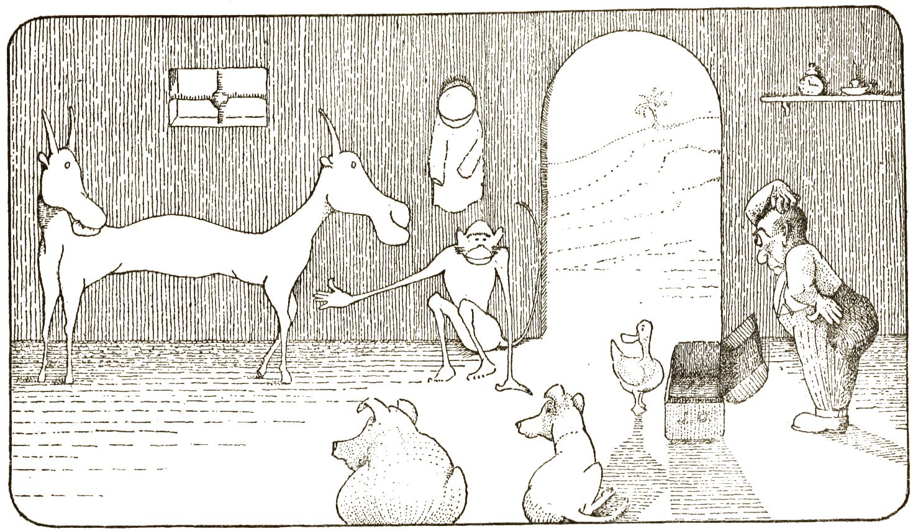

# Pushme-Pullyou

**Tools for exploring GitHub, each one a single HTML file.**

Vanilla HTML, CSS and JavaScript. No frameworks, no build tools, no server. Everything here runs on GitHub Pages or straight from a `file://` double-click.

The tools are named after the animals in Hugh Lofting's [Doctor Dolittle]( https://en.wikipedia.org/wiki/Doctor_Dolittle ) books — we spell the two-headed one **Pushme-Pullyou**, a nod to all the pushing and pulling that Git is made of. This organization's first commit was pushed in December 2016.

## The Menagerie

Each animal has one job, and together they cover GitHub from a single repo on up.

| Tool | Scope | Dolittle character | Status |
| --- | --- | --- | --- |
| [TooToo]( https://pushme-pullyou.github.io/tootoo/ ) | One repo — drop it in and the repo becomes a browsable site | Too-Too the owl, the Doctor's accountant: keeps the books of one repo | Live — [source]( https://github.com/pushme-pullyou/tootoo ) |
| GubGub | One user's whole domain, higher up — repos, gists, organizations, wikis, projects, actions, issues | Gub-Gub the pig, curious and always rooting about | In progress |
| DabDab | All of GitHub — search out interesting users, organizations and repositories by tags and topics | Dab-Dab the duck, the housekeeper: knows where everything is kept | In progress |
| JipJip | Notes — read and write Markdown notes kept in a repo, straight from the browser (the new [notesy]( https://github.com/theo-armour/sandbox/blob/main/0-apps/notesy/notesy.html )) | Jip the dog, the Doctor's faithful companion: fetches and carries | Prototype |
| Pushme-Pullyou | Between the repos — the two-headed release flow: one head publishes each animal's numbered releases, the other lets every install pull the next one when its owner chooses | The pushmi-pullyu itself, who talks to and hears from GitHub both ways | At work in [TooToo's releases]( https://github.com/pushme-pullyou/tootoo/releases ), by the rules kept in [Dolittle]( https://github.com/pushme-pullyou/dolittle ) |

And every animal is born in the same place: **[Dolittle]( https://github.com/pushme-pullyou/dolittle )**, the Doctor's workshop — the family's core: the shared rules and plans, and, as the second animal arrives, the shared code, named for the one character who isn't an animal and whose house they all live in. Each animal then grows in its own repo, which holds its source and its releases. **Pushme-Pullyou** itself, the two-headed beast, is how releases travel — one head publishes each animal's numbered releases, the other lets every install pull the next one when its owner chooses; nothing is pushed out. It can talk to and hear from GitHub, and it may well develop more special powers as we learn what it can do. So the family name stays simple: the organization is the family, this site is the front door, Dolittle is the core, and Pushme-Pullyou does the pushing and pulling.

## The Archive

The original 2016–2019 site — earlier TooToos, the first GubGub, DabDab, CheeChee, JibJib and friends — is preserved intact at:

* <https://pushme-pullyou.github.io/2019/>

Old deep links to this domain are forwarded there automatically by [404.html]( 404.html ).

## Links

* GitHub organization: <https://github.com/pushme-pullyou>
* Theo Armour: <https://theo-armour.github.io/>

## Changelog

### 2026-11-23

* TooToo's rebuild is now [pushme-pullyou/tootoo]( https://github.com/pushme-pullyou/tootoo ): its source and releases in one repo. The previous tootoo repo is [tootoo-2026]( https://github.com/pushme-pullyou/tootoo-2026 ), still active
* Dolittle stays the family's core; shared code moves in when GubGub begins
* Pushme-Pullyou now works by pull: installs take numbered releases when their owners choose, and nothing is pushed out

### 2026-10-31

* Menagerie table updated: GubGub takes the higher-level one-user view, DabDab becomes the all-GitHub explorer, JipJip is the notes animal (born from notesy), and Pushme-Pullyou joins the table as the two-headed pipeline
* The workshop got its name and its own repo: [Dolittle]( https://github.com/pushme-pullyou/dolittle ), carved out of the tootoo repo (whose 2026 combined history is archived as [tootoo-2026-10]( https://github.com/pushme-pullyou/tootoo-2026-10 ))
* Pushme-Pullyou recognized as an animal in its own right: the two-headed release pipeline that talks both ways with GitHub

### 2026-10-27

* Fresh start: new root site for the organization
* Previous site (2016–2019) renamed to [2019]( https://github.com/pushme-pullyou/2019 ) and kept publishing at [/2019/]( https://pushme-pullyou.github.io/2019/ )
* Added 404 redirect shim so old deep links land in the archive
* Named the future shared-source repo: Pushme-Pullyou, the two-headed workshop
